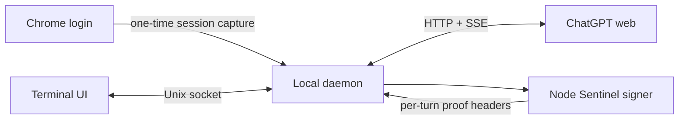

# 🌸 chatgpt-web

> A fast, Codex-inspired terminal client for your ChatGPT conversations.

`chatgpt-web` connects to an authenticated ChatGPT web session and brings it to
the terminal: streaming answers, searchable history, Markdown rendering,
syntax-highlighted code, native scrollback, and a bottom composer that feels at
home beside modern coding agents.

<p align="center">
  
</p>

> [!IMPORTANT]
> This is an experimental, unofficial client for undocumented ChatGPT web
> endpoints. It may stop working when the web application changes. It is not an
> OpenAI API client and is not affiliated with or endorsed by OpenAI.

## ✨ Highlights

- 🖥️ **Codex-style terminal UI** with a full viewport and bottom composer
- ⚡ **Streaming responses** with responsive input while generation continues
- 🔎 **Searchable resume picker** for recent conversations
- 🧠 **Persistent authentication** after a one-time interactive Chrome login
- 💾 **Offline startup restore** from an atomic local conversation snapshot
- 🚀 **Browserless operation** after authentication, including write signing
- 🎨 **Rich Markdown** with syntax-highlighted fenced code blocks
- 🖼️ **Clipboard images** uploaded and attached directly from the composer
- 📜 **Native terminal scrollback** bounded to the current session
- ↔️ **Resize-aware history** that reflows completed turns to the new width
- 🧹 **Clean history rendering** that hides internal tool-protocol payloads
- 📋 **Clipboard support** through `/copy`
- 🪶 **Zero manual environment setup** when launched with `uv`

## 🚦 Quick start

### Requirements

- Python 3.10+
- [`uv`](https://docs.astral.sh/uv/) (recommended), or `pip`
- Node.js 22+
- Chrome or Chromium for the initial login
- `wl-paste` (Wayland), `xclip` (X11), or `pngpaste` (macOS) for image paste

```bash
git clone https://github.com/tritao/chatgpt-web.git
cd chatgpt-web

# Open a dedicated Chrome profile and log in to ChatGPT.
./run login

# Capture the authenticated session, then launch the terminal UI.
./run auth
./run
```

Chrome can be closed after `auth` succeeds. The local daemon persists the
session and performs subsequent reads and writes without a running browser.

The client caches each loaded or completed conversation under
`$XDG_DATA_HOME/chatgpt-web/conversations` (normally
`~/.local/share/chatgpt-web/conversations`). Reopening the terminal UI restores
the last active conversation directly from that cache without starting the
daemon or contacting ChatGPT. Network access begins only when you send a
message or use a command that requests server data, such as `/resume` or
`/history`. `/new` clears the active-conversation pointer.

This also makes Sakura workspace restoration offline: Sakura already restores
its ChatGPT tool tab by relaunching `chatgpt-web`, which now immediately replays
the cached conversation.

To make the command available everywhere:

```bash
mkdir -p ~/.local/bin
ln -s "$(pwd)/run" ~/.local/bin/chatgpt-web
```

## 🎮 Terminal controls

| Key | Action |
| --- | --- |
| `Enter` | Send the prompt |
| `Alt+Enter` | Insert a newline |
| `Ctrl+R` | Open the searchable conversation picker |
| `Ctrl+V` | Attach a PNG image from the clipboard |
| `Ctrl+C` | Clear the prompt, or stop an active response |
| `Ctrl+D` | Exit from an empty prompt |
| `PageUp` / `PageDown` | Move through the transcript |
| Mouse wheel | Scroll the terminal's conversation history |
| `Home` / `End` | Move to the start or end of the current prompt line |
| `End` outside the prompt | Follow new output at the bottom |
| `Tab` / `Enter` | Accept a slash-command completion |
| `Escape` | Close autocomplete or the resume picker |

Type `/` to open command completion:

| Command | Action |
| --- | --- |
| `/new` | Start a new conversation |
| `/resume` | Search recent conversations |
| `/resume ID` | Open a conversation directly |
| `/history` | Reload the current conversation |
| `/rename TITLE` | Rename the current conversation |
| `/copy` | Copy the latest assistant response |
| `/remove` | Remove the latest pending image |
| `/clear` | Clear the displayed transcript |
| `/help` | Show command help |
| `/exit`, `/quit` | Exit the client |

## 🧰 Command-line usage

The same session can be used without the interactive UI:

```bash
./run list
./run list --limit 100
./run list --all --output jsonl
./run show CONVERSATION_ID
./run rename CONVERSATION_ID "New title"
./run new "Explain monads in one paragraph"
./run send CONVERSATION_ID "Continue with an example"
./run resume CONVERSATION_ID
./run status
./run stop
./run logout
```

## 🏗️ How it works



1. `login` starts Chrome with a dedicated, persistent profile.
2. `auth` captures the authenticated browser session through local Chrome
   DevTools Protocol and stores it in a mode-`0600` state file.
3. A local daemon serves CLI invocations through a mode-`0600` Unix socket.
4. Python performs conversation reads, writes, and SSE streaming directly.
5. The Node helper evaluates ChatGPT's current Sentinel proof and `dx`
   interpreters to produce per-turn write headers.

The Chrome process is therefore an authentication and compatibility bootstrap,
not a permanent transport dependency.

## 🔐 Local data and security

The saved session grants access to your ChatGPT account and must be treated like
a password.

| Data | Default location | Permissions |
| --- | --- | --- |
| Chrome profile | `~/.local/share/chatgpt-web/chrome-profile` | directory `0700` |
| Saved session | `~/.local/state/chatgpt-web/session.json` | file `0600` |
| Sentinel cache | `~/.cache/chatgpt-web/sentinel` | directory `0700`, files `0600` |
| Daemon socket | `$XDG_RUNTIME_DIR` | file `0600` |

Authentication headers and cookies move from the Chrome helper to the daemon
through a pipe and are never printed. Run `./run logout` to stop the daemon and
delete the saved credential file.

## ⚙️ Configuration

| Variable | Purpose |
| --- | --- |
| `CHATGPT_WEB_MODEL` | Model label shown by the terminal UI |
| `CHATGPT_WEB_CDP_URL` | Chrome DevTools URL when it is not on the default port |
| `CHATGPT_WEB_SEND_MODE=recipe` | Use Chrome to construct a request recipe |
| `CHATGPT_WEB_SEND_MODE=chrome` | Use the legacy browser-driven sender |

The direct sender does not retry HTTP `429` responses or unavailable composers.
This avoids retry loops that can extend a rate limit.

## 🧪 Development setup

The `run` launcher uses the PEP 723 metadata embedded in `chatgpt-web` and lets
`uv` create and cache the Python environment automatically. To install
dependencies manually:

```bash
python -m venv .venv
. .venv/bin/activate
pip install -r requirements.txt
./chatgpt-web --help
```

The browser-facing endpoints and Sentinel implementation are undocumented and
change without notice. Compatibility fixes should preserve the browser login
fallback and must never log captured credentials or proof tokens.

## ⚠️ Project status

This project is suitable for experimentation on your own account. Expect
occasional breakage, rate limits, forced reauthentication, and protocol changes.
For supported integrations and production applications, use the official OpenAI
API instead.

## Fork enhancements (dcqwqc)

This fork adds a high-contrast terminal palette, compact **inline** conversation
selector (Ctrl+R or /resume), and a compact inline slash-command list in
place of floating dialog windows. Tab completes a command; Enter runs it.

### Image generation, editing and animation

Install [image-use](https://github.com/leeguooooo/image-use) separately.
The fork delegates media generation to this local executable. It does not
send generated files into the current ChatGPT conversation automatically.

| Interactive command | Action |
| --- | --- |
| /image A cozy solarpunk greenhouse | Generate a PNG |
| /edit ~/Pictures/room.png \| Add plants | Edit an existing picture |
| /edit \| Make it purple | Edit last generated image |
| /animate A pixel kitten walking | Render animated WebP |

The standalone interface also returns machine-readable JSON:

~~~bash
chatgpt-web image generate --prompt "A tiny house in a forest" --backend auto
chatgpt-web image edit --reference ./room.png --prompt "Warm sunset light"
chatgpt-web image animate --prompt "A waving pixel character"
~~~

The JSON response includes ok and, on success, output, backend, action, and
elapsed_seconds. Files default to ~/.local/share/chatgpt-web/images/.
There is **no public service or MCP endpoint**. Connecting this to an MCP
service later requires authorization, rate limits, and safe file access.

The default image backend is auto. It prefers the browser-backed service
(requires chrome-use plus its browser extension) but may fall back to Codex
OAuth, which **consumes metered Codex usage**. To disable fallback, set
CHATGPT_WEB_IMAGE_BACKEND=web. To force Codex, set
CHATGPT_WEB_IMAGE_BACKEND=codex. No image generations happen unless explicitly
requested. The image-use service and the ChatGPT web session are unofficial;
both may break when providers change.

Run checks:

~~~bash
python3 -m unittest discover -s tests -v
chatgpt-web image --help
image-use doctor
~~~

The original upstream repository currently does not list a software license;
review redistribution permissions before packaging this fork elsewhere.

### Model selection and CLI Project isolation

All newly created chats (interactive or scripted) are routed to the ChatGPT
Project named **CLI**. Project resolution uses the authenticated account's
Project listing and requires exactly one exact-name match. A new chat must
also be confirmed as belonging to that Project after submission; if the
server returns another parent, the request fails and the client attempts
to delete only that newly created, misrouted chat. Resuming or sending to
existing chats outside the CLI Project is blocked. There is deliberately
no silent fallback to the top-level chat history. Earlier chats are not moved.

Project and model selections are stored privately under
~/.config/chatgpt-web/settings.json (mode 0600), never in the git repository.
The UI shows the selected model and CLI Project.

Interactive commands:

- /model opens the compact inline model picker (search, arrows, Enter, Esc).
- /model gpt-6-thinking changes and persists the selected model.
- /usage explains the available ChatGPT Web quota information.

Scripted commands:

~~~bash
chatgpt-web project
chatgpt-web model
chatgpt-web model gpt-6-thinking
chatgpt-web usage
chatgpt-web list
chatgpt-web new "Hello from the CLI Project"
~~~

The model picker reads the current model catalog from your signed-in ChatGPT
account; eligibility, output quality, and model availability are controlled
by ChatGPT. ChatGPT Web does not expose a reliable numeric remaining-message
counter to this client. The Codex/Work quota endpoint is a **different**
allowance and is not mislabeled as regular Web usage. The usage command
returns null rather than inventing a remaining amount.

For image-use: browser-backed image conversations use the CLI Project with
strict project verification (no fallback to the ordinary chat list).
When chrome-use is absent, the auto backend uses Codex image generation,
which does not create a regular ChatGPT Web conversation but consumes Codex
usage. To require the web-based image workflow use the web backend explicitly.

### Inline image previews and neutral theme

The terminal now **displays generated and edited images directly in the
conversation** without opening another application. It renders a compact
full-color preview using 24-bit ANSI half-block pixels, compatible with
Ghostty, Kitty, tmux and terminals supporting truecolor. The original PNG
or WebP is preserved at full resolution, and the displayed preview is
independent of any browser-session cookie or image-hosting service.

- `/image PROMPT`: generate an image and show its preview.
- `/edit PATH | PROMPT`: edit a reference and show the result.
- `/animate PROMPT`: preview the first frame of the WebP/GIF animation.
- `/preview PATH`: preview a local image without generating another.
- `/preview`: show the most recently previewed/generated image in this session.

The client uses Pillow for image previews; the preview is embedded in terminal
scrollback, but animated images are represented by their first frame. The
palette uses a **charcoal background, warm white text and subtle amber accents**
with no blue-tinted panels. Assistant messages and scrollback are explicitly
styled to remain legible when a terminal has a white default background.

The model picker uses a seven-item *sliding viewport*. It always shows the
selected model when pressing Up/Down, and queues arrow presses made while the
model list is loading. Pressing Enter on a complete slash command executes it
immediately; previously a stale completion could swallow the first Enter.

The `/usage` command now reports two separate categories:

- **Ordinary ChatGPT Web:** exact remaining message counts are not supplied
  to the client, so no number is invented.
- **Codex / Work:** if available, the actual remaining percentages and reset
  countdowns from the account's separate usage endpoint.

CLI `chatgpt-web usage` returns the same data as structured JSON.

### Native high-definition images

Direct Ghostty and Kitty sessions now use native raster graphics instead of ANSI half-block pixels. Run /hd to display the last image in the terminal or /open to open the original full-resolution file in the desktop viewer. Run /preview PATH to show an image using automatic terminal detection. In tmux, /hd uses explicit passthrough while the default stays conservative. The original image remains unchanged.

### ChatGPT Web usage research

The account model catalog and normal quota-related response headers did not reveal a reliable remaining Web message counter. The common usage and limits URL paths returned 404. Codex percentages remain separately labeled and exact Web message balances are not fabricated.

### Persistent image prompts and conversation history

Image commands now appear in the chat transcript as user messages before
generation starts. The completed response repeats the full image prompt,
records the image's saved path, and keeps its result after restarting the TUI.

The client maintains an on-disk, private local session journal under
~/.local/share/chatgpt-web/local-history/. It includes local image-only
sessions as well as the visible transcript surrounding regular CLI Project
chats. The active session is restored automatically after quitting and
restarting. The Ctrl+R and /resume picker merges real CLI Project chats,
local-only sessions and earlier cached pre-Project chats, labeled read-only.

No previous normal chat is silently moved or given permission to write
outside the CLI Project. Resuming a pre-Project cached chat displays its
old messages; a *new* message creates a new CLI Project chat instead.
When ChatGPT is rate-limited, already cached CLI chats and local image-only
sessions can still be opened offline. Sending replies still requires the
live Project-enforced backend.

Older generated images still present in the local images folder are
automatically indexed as recovered media, without inventing prompts that
weren't previously recorded. Recovery never deletes or modifies image files
and never switches the active chat. Local session journals are written
atomically with private (0600) permissions.

### Image output from ordinary prompts, persistent display, and lavender theme

The TUI now saves image outputs generated by ChatGPT Web during **normal chat**
turns, not just /image. It detects image asset pointers in assistant and image
tool results, requests a signed download URL through the authenticated account,
validates the image bytes, and stores an original local file under
~/.local/share/chatgpt-web/images/web-generated/. User-uploaded images are not
mistaken for generated results. The saved image is appended to the conversation
and to local session history, so it remains accessible on redraw and restart.

The original, fragile automatic Ghostty/Kitty graphics overlay was drawn
outside prompt-toolkit's transcript and disappeared on the next repaint.
Automatic previews now **always render as persistent inline transcript image
entries**. These use a higher-resolution ANSI color-cell fallback that
survives scrolling and redraws. To see the original pixels at full resolution,
use /open. The /hd command remains an explicit native-graphics preview for
compatible terminals; its temporary appearance depends on terminal redraws.
Full native-pixel rendering in a constantly repainted TUI is not guaranteed.

Lavender-purple accents replace the warm yellow highlights. On terminal
startup the CLI temporarily sets the default terminal background to charcoal
using OSC 11 (including Ghostty's background-colored padding) and restores
the terminal's original background when exiting using OSC 111. This does not
edit the user's global Ghostty / Caelestia color configuration. Set
CHATGPT_WEB_KEEP_TERMINAL_BG=1 to disable these background OSC operations.

### Shell-style prompt history and ChatGPT rate-limit countdowns

The main composer now supports **Up/Down for previous submitted prompts**.
Up recalls older prompts, Down goes forward and eventually restores the
unsent draft. Inside a multiline message, the arrows still navigate lines
until you reach the first/last line. The model and conversation selection
panels keep their own Up/Down navigation. The CLI reads previous user prompts
from its private local session history, so recall works after restarting.

When ChatGPT Web returns HTTP 429 with a Retry-After number, the TUI displays
a **live second-by-second countdown** in the failed assistant message and in
the bottom-right status bar. These are the same server-provided deadline,
not two independent estimates. Existing messages remain visible while the
countdown runs. At expiry, the inline error reads *ready to retry*, the
status bar returns to Ready, and the finished transcript is committed once
without duplicating previous scrollback.

While that countdown is running, normal chat sends are held and the draft
remains in the composer. The failed request is restored to the input if the
user has not already typed another draft. Slash commands such as /usage and
/model remain available. The saved local session includes the deadline, so
the countdown survives a restart without resetting to the original duration.
There is **no automatic retry** and no polling or artificial rate-limit
bypass. Retry-After is a temporary request cooldown, not the ChatGPT Web
subscription usage balance.

### Ghostty/Kitty native HD inline images and saved original links

On a **direct Ghostty or Kitty** terminal, the image renderer now uses the
Kitty graphics protocol's **virtual placements and Unicode placeholders**
(`U=1`, `U+10EEEE`, row/column diacritics). This is different from the old
half-block ANSI preview: real PNG pixel data is uploaded to the terminal, and
the placement is anchored to ordinary text cells so it stays in the terminal
layout across redrawing and scrolling. The original image remains unmodified.

Beneath **every** inline image the CLI displays an explicit, selectable
`file:///...` URI showing exactly where the original was saved, along with
the `/open` command. The link/path is still displayed if the image preview
cannot be drawn. Use `/open` to view and zoom into the full-resolution file
in your desktop image viewer.

If Ghostty is being run inside tmux, over SSH or a terminal without Kitty
Unicode placeholders, the app conservatively uses the older ANSI fallback.
For debugging a terminal that claims native support but renders blank cells,
launch with `CHATGPT_WEB_IMAGE_MODE=ansi chatgpt-web`; the saved file URI and
`/open` command are available in either mode.

This protocol implementation is tested for the exact image upload packets,
consistent per-cell foreground color and Unicode diacritics, terminal
redraw, session reflow, and saved file links. It does not require the image
to be regenerated or change ChatGPT account usage.

### Fast recent-conversation loading (cache-first)

The /resume (Ctrl+R) conversation picker now opens from the **local journal
and saved CLI Project cache immediately**, without waiting for the ChatGPT
website, authentication refresh or the background daemon. The cached list is
searchable and selectable while a separate online refresh runs. When remote
data arrives, the picker merges it with the local entries and preserves the
current filter and selection. A failed or slow request leaves the local list
fully usable and visibly reports that refreshing is unavailable.

To avoid tying up the single-threaded chat daemon, the picker requests only
the newest page of online CLI Project conversations, with a **6-second HTTP
timeout** and a **9-second IPC timeout**. Older Project chats remain accessible
through their cached entries; this quick online refresh is not a claim that
every historical server chat has been enumerated. The ordinary complete
listing command remains available separately. Chat submission still validates
Project membership and never routes new messages into personal chat history.

Selecting a conversation already cached locally loads it without a network
round-trip. Online-only conversations still require one ChatGPT request.
Closing/reopening the picker invalidates earlier in-flight refresh results
so stale network responses cannot replace the current selection.

### Ghostty HD images: visually verified, 2026-10-16

The old Kitty Unicode-placeholder placement (U=1) produced a blank rectangle
in a REAL Ghostty 1.3.1 window. A direct Kitty PNG placement rendered correctly.
The production CLI now sends full-color PNG images to terminal scrollback while
prompt_toolkit is suspended, using a compact input footer that does not erase
the picture on redraw. Image height is bounded by available terminal rows.
The saved original file URI and /open remain visible underneath.

We verified the updated CLI by taking a real Ghostty screenshot AFTER a
normal-language synthetic image request had finished: the PNG, prompt,
caption and composer were all visible. Non-Kitty terminals use ANSI fallback.

### Prompt submission progress and bounded preparation

The secure-request status now distinguishes CLI Project validation,
verification proof generation, requirements retrieval, proof completion,
request submission, waiting for ChatGPT, and media saving. A single-worker
daemon previously could block its readiness ping for 120 seconds. The new
1.5-second ping fails fast and preserves the draft while the backend is busy.
The proof processes have 15-second limits, requirements retrieval has a
12-second limit. Normal service verification is still required.

All failed sends preserve the unsent prompt; no automatic retry occurs because
network errors may leave submission status uncertain. The 429 cooldown
continues to report only real Retry-After times.

### Non-disruptive daemon upgrade

CLI version 2 uses a versioned daemon-v2.sock as its default socket.
An older process still handling a request on daemon.sock is left intact;
new invocations start and use the upgraded backend without interrupting
that operation. Explicit --socket PATH can still connect to a particular
daemon if needed. This is a service migration, not a reset of Project,
model selection, conversation history, authentication, or generated images.

### Simultaneous CLI terminals (2026-10-16)

The daemon now serves independent terminal requests concurrently (up to eight
active requests per local server), rather than keeping every new client behind
a single long-running image-generation or text-stream operation. Each worker
has independent authenticated HTTP state and stream events. Pings are handled
on the accepting thread and stay responsive during active generations.
A separate session's /resume, /model and /usage can also run while another
chat is generating.

Launching chatgpt-web starts a NEW local conversation for that terminal;
this avoids silently opening the same last-active conversation twice.
Old chats are still available in /resume (Ctrl+R), and explicit
chatgpt-web resume CONVERSATION_ID still restores the requested chat.

If two terminals select the SAME conversation and attempt to send together,
the later send receives a clear same-conversation conflict; independent
conversations proceed in parallel. This protects against losing a branch
or overwriting messages in shared conversation history. ChatGPT account
quota and rate limits remain shared and cannot be bypassed by parallel clients.

The upgraded backend uses daemon-v4.sock so an older busy daemon and its
existing CLI session can finish safely without being killed. Restart both
CLI windows to use the concurrent server. Per-thread temporary files prevent
auth/session and conversation cache corruption during parallel writes.

### Interactive chat continuity and structured responses

The interactive terminal can resume recent ChatGPT conversations, including
conversations created outside the dedicated CLI Project. It retrieves and
checks the selected server conversation before sending a reply, preserves
the conversation's original Project (or no Project), and stops if the server
returns a different conversation. New chats still start in the CLI Project.
Noninteractive daemon calls and scripts continue to enforce CLI Project
isolation unless a caller explicitly uses the interactive-only opt-in flag.

The response viewer renders basic structured ChatGPT text elements such as
badges, links and headings as Markdown. Images, rich charts, widgets and
interactive controls show honest text fallbacks, not raw angle-bracket tags
or fake working controls. For full ChatGPT interactions, type `/web` to
open the active conversation in the browser. Use `/copy` to copy the latest
assistant response and `/copy code 1` to copy its first fenced code block.
Image previews still work as before.

The upgraded backend uses its own versioned daemon-v4 socket and does not
stop older daemon instances or active requests.

### BB / ACP provider (Philipedia)

The BB integration lives in `bb_acp.py`. It exposes this authenticated ChatGPT Web CLI as the custom `acp-chatgpt-web` provider via Agent Client Protocol v1. The provider advertises the live account model catalog, excluding internal/reserved entries, and selects the model **per request** instead of mutating the user's global CLI model. It supports persistent ACP session IDs mapped to CLI Project conversations, model switching, JSONL streaming, cancellation, and history replay on session load. Existing BB custom provider definitions are preserved when registering this provider.

BB displays **four model families** (GPT-6, GPT-6 Mini, GPT-5.6 Sol,
GPT-5.6 Luna), rather than ten repeated model variants. The native BB
**Reasoning** row selects the real ChatGPT operating variant: Auto, Instant,
Thinking, and Extended for full-size models; Instant and Thinking for Mini.
Auto is available only where the account lists the native `auto` slug;
there is no synthetic switching or task-based model router. Thinking maps to
the account's `standard` effort, and Extended to `extended`, on variants
that advertise configurable thinking. Mini Thinking is a fixed-effort
model; Extended is deliberately unavailable.

BB does not currently support a conditionally visible thinking-depth
control in its core model picker: it would advertise Extended even for Mini
models. Folding depth into the existing native Reasoning row keeps every
option truthful while retaining BB's original UI and accessibility.
The ACP adapter resolves model/mode combinations per request, independently
per conversation, without changing the global CLI model. On load it migrates
old per-variant session records, preserving conversation IDs and the selected
thinking effort. Internal/reserved models are excluded. The compact BB icon
extension in `bb-plugin-provider-icons/` overrides native Codex and Codex
Lina with the Codex mark, and ChatGPT Web CLI with the ChatGPT knot, using
BB's supported providerIcon slot and local validated SVG assets.

The agent is **text-only advisory**: it does not implement coding tool calls, filesystem access, shell execution, or BB workspace mutation. Never interpret its prose as evidence that repository changes were made. It uses the browser-authenticated ChatGPT Web service, not the OpenAI API or Codex quota; account/rate limits and account model access apply.

The CLI requires an existing authenticated Chrome profile and its existing ChatGPT Project named `CLI`. The project lookup follows all sidebar pagination cursors and verifies the saved Project ID. If ChatGPT's signer changes or the Chrome session presents a human verification challenge, sending **fails closed**; the user must resolve interactive verification or use a supported alternative provider. This adapter does not bypass website verification.

Sanity checks:

```sh
chatgpt-web status
chatgpt-web project
chatgpt-web model
bb provider list
bb provider models acp-chatgpt-web --json
PYTHONPATH=. python3 -m unittest discover -s tests -p 'test_*.py' -q
```
