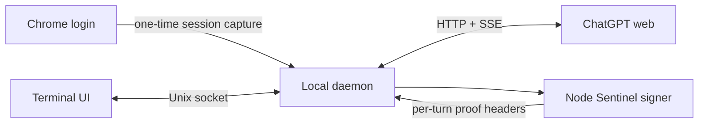

# 🌸 chatgpt-web

> A fast, Codex-inspired terminal client for your ChatGPT conversations.

`chatgpt-web` connects to an authenticated ChatGPT web session and brings it to
the terminal: streaming answers, searchable history, Markdown rendering,
syntax-highlighted code, native scrollback, and a bottom composer that feels at
home beside modern coding agents.

<p align="center">
  
</p>

> [!IMPORTANT]
> This is an experimental, unofficial client for undocumented ChatGPT web
> endpoints. It may stop working when the web application changes. It is not an
> OpenAI API client and is not affiliated with or endorsed by OpenAI.

## ✨ Highlights

- 🖥️ **Codex-style terminal UI** with a full viewport and bottom composer
- ⚡ **Streaming responses** with responsive input while generation continues
- 🔎 **Searchable resume picker** for recent conversations
- 🧠 **Persistent authentication** after a one-time interactive Chrome login
- 💾 **Offline startup restore** from an atomic local conversation snapshot
- 🚀 **Browserless operation** after authentication, including write signing
- 🎨 **Rich Markdown** with syntax-highlighted fenced code blocks
- 🖼️ **Clipboard images** uploaded and attached directly from the composer
- 📜 **Native terminal scrollback** bounded to the current session
- ↔️ **Resize-aware history** that reflows completed turns to the new width
- 🧹 **Clean history rendering** that hides internal tool-protocol payloads
- 📋 **Clipboard support** through `/copy`
- 🪶 **Zero manual environment setup** when launched with `uv`

## 🚦 Quick start

### Requirements

- Python 3.10+
- [`uv`](https://docs.astral.sh/uv/) (recommended), or `pip`
- Node.js 22+
- Chrome or Chromium for the initial login
- `wl-paste` (Wayland), `xclip` (X11), or `pngpaste` (macOS) for image paste

```bash
git clone https://github.com/tritao/chatgpt-web.git
cd chatgpt-web

# Open a dedicated Chrome profile and log in to ChatGPT.
./run login

# Capture the authenticated session, then launch the terminal UI.
./run auth
./run
```

Chrome can be closed after `auth` succeeds. The local daemon persists the
session and performs subsequent reads and writes without a running browser.

The client caches each loaded or completed conversation under
`$XDG_DATA_HOME/chatgpt-web/conversations` (normally
`~/.local/share/chatgpt-web/conversations`). Reopening the terminal UI restores
the last active conversation directly from that cache without starting the
daemon or contacting ChatGPT. Network access begins only when you send a
message or use a command that requests server data, such as `/resume` or
`/history`. `/new` clears the active-conversation pointer.

This also makes Sakura workspace restoration offline: Sakura already restores
its ChatGPT tool tab by relaunching `chatgpt-web`, which now immediately replays
the cached conversation.

To make the command available everywhere:

```bash
mkdir -p ~/.local/bin
ln -s "$(pwd)/run" ~/.local/bin/chatgpt-web
```

## 🎮 Terminal controls

| Key | Action |
| --- | --- |
| `Enter` | Send the prompt |
| `Alt+Enter` | Insert a newline |
| `Ctrl+R` | Open the searchable conversation picker |
| `Ctrl+V` | Attach a PNG image from the clipboard |
| `Ctrl+C` | Clear the prompt, or stop an active response |
| `Ctrl+D` | Exit from an empty prompt |
| `PageUp` / `PageDown` | Move through the transcript |
| Mouse wheel | Scroll the terminal's conversation history |
| `Home` / `End` | Move to the start or end of the current prompt line |
| `End` outside the prompt | Follow new output at the bottom |
| `Tab` / `Enter` | Accept a slash-command completion |
| `Escape` | Close autocomplete or the resume picker |

Type `/` to open command completion:

| Command | Action |
| --- | --- |
| `/new` | Start a new conversation |
| `/resume` | Search recent conversations |
| `/resume ID` | Open a conversation directly |
| `/history` | Reload the current conversation |
| `/rename TITLE` | Rename the current conversation |
| `/copy` | Copy the latest assistant response |
| `/remove` | Remove the latest pending image |
| `/clear` | Clear the displayed transcript |
| `/help` | Show command help |
| `/exit`, `/quit` | Exit the client |

## 🧰 Command-line usage

The same session can be used without the interactive UI:

```bash
./run list
./run list --limit 100
./run list --all --output jsonl
./run show CONVERSATION_ID
./run rename CONVERSATION_ID "New title"
./run new "Explain monads in one paragraph"
./run send CONVERSATION_ID "Continue with an example"
./run resume CONVERSATION_ID
./run status
./run stop
./run logout
```

## 🏗️ How it works



1. `login` starts Chrome with a dedicated, persistent profile.
2. `auth` captures the authenticated browser session through local Chrome
   DevTools Protocol and stores it in a mode-`0600` state file.
3. A local daemon serves CLI invocations through a mode-`0600` Unix socket.
4. Python performs conversation reads, writes, and SSE streaming directly.
5. The Node helper evaluates ChatGPT's current Sentinel proof and `dx`
   interpreters to produce per-turn write headers.

The Chrome process is therefore an authentication and compatibility bootstrap,
not a permanent transport dependency.

## 🔐 Local data and security

The saved session grants access to your ChatGPT account and must be treated like
a password.

| Data | Default location | Permissions |
| --- | --- | --- |
| Chrome profile | `~/.local/share/chatgpt-web/chrome-profile` | directory `0700` |
| Saved session | `~/.local/state/chatgpt-web/session.json` | file `0600` |
| Sentinel cache | `~/.cache/chatgpt-web/sentinel` | directory `0700`, files `0600` |
| Daemon socket | `$XDG_RUNTIME_DIR` | file `0600` |

Authentication headers and cookies move from the Chrome helper to the daemon
through a pipe and are never printed. Run `./run logout` to stop the daemon and
delete the saved credential file.

## ⚙️ Configuration

| Variable | Purpose |
| --- | --- |
| `CHATGPT_WEB_MODEL` | Model label shown by the terminal UI |
| `CHATGPT_WEB_CDP_URL` | Chrome DevTools URL when it is not on the default port |
| `CHATGPT_WEB_SEND_MODE=recipe` | Use Chrome to construct a request recipe |
| `CHATGPT_WEB_SEND_MODE=chrome` | Use the legacy browser-driven sender |

The direct sender does not retry HTTP `429` responses or unavailable composers.
This avoids retry loops that can extend a rate limit.

## 🧪 Development setup

The `run` launcher uses the PEP 723 metadata embedded in `chatgpt-web` and lets
`uv` create and cache the Python environment automatically. To install
dependencies manually:

```bash
python -m venv .venv
. .venv/bin/activate
pip install -r requirements.txt
./chatgpt-web --help
```

The browser-facing endpoints and Sentinel implementation are undocumented and
change without notice. Compatibility fixes should preserve the browser login
fallback and must never log captured credentials or proof tokens.

## ⚠️ Project status

This project is suitable for experimentation on your own account. Expect
occasional breakage, rate limits, forced reauthentication, and protocol changes.
For supported integrations and production applications, use the official OpenAI
API instead.

## Fork enhancements (dcqwqc)

This fork adds a high-contrast terminal palette, compact **inline** conversation
selector (Ctrl+R or /resume), and a compact inline slash-command list in
place of floating dialog windows. Tab completes a command; Enter runs it.

### Image generation, editing and animation

Install [image-use](https://github.com/leeguooooo/image-use) separately.
The fork delegates media generation to this local executable. It does not
send generated files into the current ChatGPT conversation automatically.

| Interactive command | Action |
| --- | --- |
| /image A cozy solarpunk greenhouse | Generate a PNG |
| /edit ~/Pictures/room.png \| Add plants | Edit an existing picture |
| /edit \| Make it purple | Edit last generated image |
| /animate A pixel kitten walking | Render animated WebP |

The standalone interface also returns machine-readable JSON:

~~~bash
chatgpt-web image generate --prompt "A tiny house in a forest" --backend auto
chatgpt-web image edit --reference ./room.png --prompt "Warm sunset light"
chatgpt-web image animate --prompt "A waving pixel character"
~~~

The JSON response includes ok and, on success, output, backend, action, and
elapsed_seconds. Files default to ~/.local/share/chatgpt-web/images/.
There is **no public service or MCP endpoint**. Connecting this to an MCP
service later requires authorization, rate limits, and safe file access.

The default image backend is auto. It prefers the browser-backed service
(requires chrome-use plus its browser extension) but may fall back to Codex
OAuth, which **consumes metered Codex usage**. To disable fallback, set
CHATGPT_WEB_IMAGE_BACKEND=web. To force Codex, set
CHATGPT_WEB_IMAGE_BACKEND=codex. No image generations happen unless explicitly
requested. The image-use service and the ChatGPT web session are unofficial;
both may break when providers change.

Run checks:

~~~bash
python3 -m unittest discover -s tests -v
chatgpt-web image --help
image-use doctor
~~~

The original upstream repository currently does not list a software license;
review redistribution permissions before packaging this fork elsewhere.

### Model selection and CLI Project isolation

All newly created chats (interactive or scripted) are routed to the ChatGPT
Project named **CLI**. Project resolution uses the authenticated account's
Project listing and requires exactly one exact-name match. A new chat must
also be confirmed as belonging to that Project after submission; if the
server returns another parent, the request fails and the client attempts
to delete only that newly created, misrouted chat. Resuming or sending to
existing chats outside the CLI Project is blocked. There is deliberately
no silent fallback to the top-level chat history. Earlier chats are not moved.

Project and model selections are stored privately under
~/.config/chatgpt-web/settings.json (mode 0600), never in the git repository.
The UI shows the selected model and CLI Project.

Interactive commands:

- /model opens the compact inline model picker (search, arrows, Enter, Esc).
- /model gpt-6-thinking changes and persists the selected model.
- /usage explains the available ChatGPT Web quota information.

Scripted commands:

~~~bash
chatgpt-web project
chatgpt-web model
chatgpt-web model gpt-6-thinking
chatgpt-web usage
chatgpt-web list
chatgpt-web new "Hello from the CLI Project"
~~~

The model picker reads the current model catalog from your signed-in ChatGPT
account; eligibility, output quality, and model availability are controlled
by ChatGPT. ChatGPT Web does not expose a reliable numeric remaining-message
counter to this client. The Codex/Work quota endpoint is a **different**
allowance and is not mislabeled as regular Web usage. The usage command
returns null rather than inventing a remaining amount.

For image-use: browser-backed image conversations use the CLI Project with
strict project verification (no fallback to the ordinary chat list).
When chrome-use is absent, the auto backend uses Codex image generation,
which does not create a regular ChatGPT Web conversation but consumes Codex
usage. To require the web-based image workflow use the web backend explicitly.

### Inline image previews and neutral theme

The terminal now **displays generated and edited images directly in the
conversation** without opening another application. It renders a compact
full-color preview using 24-bit ANSI half-block pixels, compatible with
Ghostty, Kitty, tmux and terminals supporting truecolor. The original PNG
or WebP is preserved at full resolution, and the displayed preview is
independent of any browser-session cookie or image-hosting service.

- `/image PROMPT`: generate an image and show its preview.
- `/edit PATH | PROMPT`: edit a reference and show the result.
- `/animate PROMPT`: preview the first frame of the WebP/GIF animation.
- `/preview PATH`: preview a local image without generating another.
- `/preview`: show the most recently previewed/generated image in this session.

The client uses Pillow for image previews; the preview is embedded in terminal
scrollback, but animated images are represented by their first frame. The
palette uses a **charcoal background, warm white text and subtle amber accents**
with no blue-tinted panels. Assistant messages and scrollback are explicitly
styled to remain legible when a terminal has a white default background.

The model picker uses a seven-item *sliding viewport*. It always shows the
selected model when pressing Up/Down, and queues arrow presses made while the
model list is loading. Pressing Enter on a complete slash command executes it
immediately; previously a stale completion could swallow the first Enter.

The `/usage` command now reports two separate categories:

- **Ordinary ChatGPT Web:** exact remaining message counts are not supplied
  to the client, so no number is invented.
- **Codex / Work:** if available, the actual remaining percentages and reset
  countdowns from the account's separate usage endpoint.

CLI `chatgpt-web usage` returns the same data as structured JSON.
